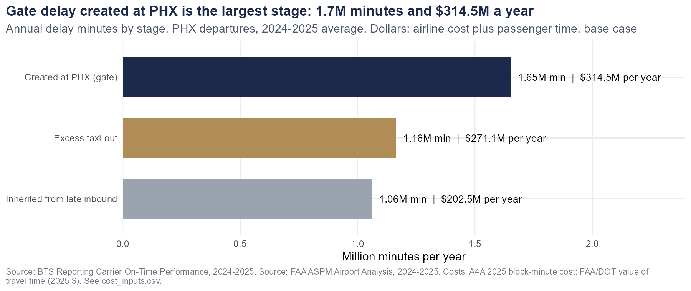

# PHX Departure Operations

A consulting-style diagnostic of Phoenix Sky Harbor (PHX) departures built entirely on public federal data: where time is lost between the gate and takeoff, which single fix has the best return, and which stage breaks first if traffic grows 15%.

## Findings (2024-2025)

| | |
|---|---|
| Gate delay per year | 2.71 million minutes, 60.9% of it created at PHX and the rest inherited from late inbound aircraft |
| Excess taxi-out per year | 1.16 million minutes beyond FAA's unimpeded taxi time |
| Largest stage | Gate delay created at PHX, about $314.5M a year (airline cost plus passenger time, base case) |
| Recommendation | Thin the 7-11 AM departure bank: 68.1% of the recoverable taxi queue, about $95.8M a year in the base case. Southwest and American schedule most of it |
| Degrades first at +15% traffic | Excess taxi-out: +23.1% annual minutes, 7.1% worse per departure. Gate delay grows only with flight count (0.1% per departure) |



## Reproduce

Prerequisites: R 4.6, `renv`, Quarto with TinyTeX (`quarto install tinytex`).

```
# 1. choose a cache folder outside the repo (about 1.3 GB of national source files)
setx PHX_CACHE_DIR C:/DataCache/PHX_Airport_Ops        # Windows; use export on macOS/Linux
# 2. restore packages, then run everything (about 45 minutes, mostly downloads and PDF parsing)
Rscript -e "renv::restore()"
Rscript R/run_all.R
```

Scripts run in numbered order: `01` download, `02` clean, `03` validate, `04` build the flight table, `10`-`15` Act 1, `20` stage ranking and dollars, `30` growth scenarios, `41`-`44` deck, page, video script and this README. Every number in the report, deck, page and README is read from `output/tables/headline_numbers.csv`.

## Data

| Source | Link |
|---|---|
| BTS Reporting Carrier On-Time Performance | https://www.transtats.bts.gov/Tables.asp?QO_VQ=EFD |
| FAA ASPM Airport Analysis and OPSNET (saved from the browser forms; query settings in each file) | https://www.aspm.faa.gov |
| KPHX hourly weather, Iowa Environmental Mesonet ASOS archive | https://mesonet.agron.iastate.edu/request/download.phtml |
| TSA checkpoint throughput, FOIA reading room | https://www.tsa.gov/foia/readingroom |
| Cost inputs (A4A, FAA/DOT value of time, FAA seats and load factors) | `data/reference/cost_inputs.csv` |

## Limitations

- Scope starts at the gate. Curb, check-in, security wait times and gate assignment are not publicly measured and are excluded.
- BTS covers domestic flights of the larger U.S. carriers, about 79.7% of PHX operations by FAA count.
- BTS delay causes are airline-reported and exist only for flights arriving 15+ minutes late.
- TSA data is passenger counts only. No wait times are implied.
- Act 2 is a projection fitted on observed PHX hours, assuming proportional schedule growth and today's infrastructure.
- Dollar figures depend on published unit costs (see `cost_inputs.csv`). Fix costs are not public, so value is recoverable value per year, not ROI.

## Documents

| File | What it is |
|---|---|
| `report/phx_departure_operations.pdf` | Full written report |
| `slides/PHX_Departure_Operations.pptx` | Presentation deck with speaker notes |
| `site/index.html` | One-page summary |
| `video/script.md`, `video/summary_cut.md` | Video scripts |
| `PLAN.md`, `docs/method_decisions.md`, `docs/phase0_memo.md`, `docs/DATA_SOURCES.md` | Plan, method choices, feasibility check, source notes |

